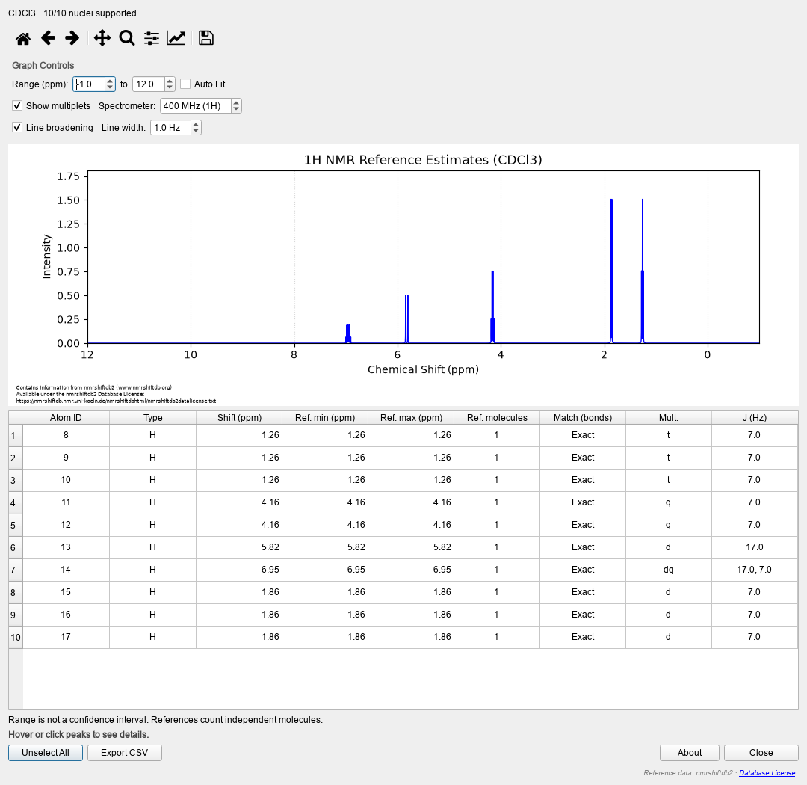
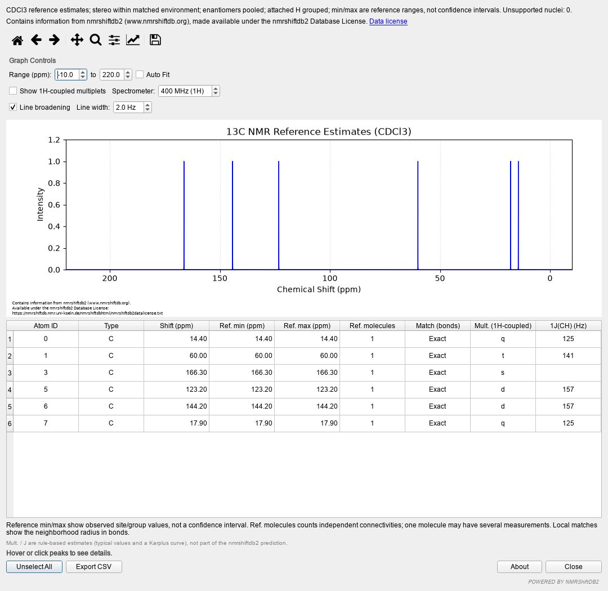

# NMR Prediction Plugin for MoleditPy

[](https://github.com/HiroYokoyama/moleditpy_nmr_predicator_nmrshiftdb2/actions/workflows/test.yml)

[](https://github.com/HiroYokoyama/moleditpy_nmr_predicator_nmrshiftdb2/tags)
[](https://github.com/HiroYokoyama/moleditpy_nmr_predicator_nmrshiftdb2/releases)

Offline 1H/13C chemical-shift estimates from **nmrshiftdb2 experimental data**,
using an original **Python + RDKit** reference search. The ZIP includes prepared reference data and runs offline; no Java runtime
or first-run data generation is required.

## Install and use

Install the complete release ZIP through MoleditPy's Plugin Manager, or extract
its `nmr_predicator_nmrshiftdb2/` folder into your user plugin directory. Keep the
`data/` folder and notices alongside the code. MoleditPy supplies the Python,
RDKit, Qt and visualization environment.

Choose **Analysis → NMR Prediction (nmrshiftdb2)**, a nucleus, and a reference solvent. The result window
shows chemical shifts, reference ranges, independent reference counts, match
types, estimated coupling patterns and a
spectrum. Table/peak selections highlight the corresponding atoms in 3D.
Multiplets and Lorentzian broadening remain optional. CSV export includes
couplings and the data attribution. The result window and plots identify the
reference data and its license.

## What the estimates mean

- The GUI offers **CDCl3, DMSO-d6, CD3OD, D2O, acetone-d6, C6D6,
  pyridine-d5, THF-d8, CD3CN and CCl4**. Only the selected solvent contributes
  references. Unreported, ambiguous and mixed solvents are excluded; there is
  no fallback to another solvent. Availability varies substantially by solvent.
  Reported temperatures are restricted to 273–323 K; unreported temperatures
  are included. There is no temperature/concentration correction.
- A known stereostructure can use its experimental reference-group median. Other
  structures search rooted neighborhoods from radius 4 down to 2, requiring at
  least **three independent molecular connectivities** for a local estimate.
- Duplicate spectra and symmetric sites are aggregated within a molecular
  connectivity before combining independent references.
- **E/Z bonds and tetrahedral configurations are part of the search keys.**
  Unspecified configurations stay separate from specified ones within the
  matched environment. A 3D conformer can supply missing stereochemical tags;
  existing specified tags are retained. Enantiomers share references in the
  supported achiral solvents, while diastereomers remain distinct. Local matches
  only account for stereochemistry within their matched neighborhood.
- Every carbon-bound proton on a given carbon gets the same group estimate;
  stereospecific/diastereotopic H shifts and exchangeable OH/NH/SH protons are
  not modeled. Enhanced and non-tetrahedral stereochemistry are unsupported.
- Charged molecules, radicals, disconnected structures, unsupported elements,
  and isotope substitutions other than 1H/13C are rejected. The heavy-atom limit
  is 256. Missing references are reported as unsupported, not replaced by guesses.
- **Reference min/max show the contributing experimental site/group values,
  not a confidence interval.** `Ref. molecules` counts independent molecular
  connectivities; repeated measurements can widen the range but never inflate
  that count. A single reference with a narrow or zero range is not evidence of
  high accuracy. `Exact` identifies the same stereostructure; `Local (n)` shows
  the neighborhood radius in bonds. These fields and the selected solvent are
  included in CSV exports.
- Multiplicity and J remain separate rule-based approximations in `coupling.py`,
  not experimental fits or output of this shift estimator.

Reference-search estimates support exploratory interpretation. Treat unsupported
sites and the reported reference ranges/counts explicitly when assigning peaks.

## Validation

The pinned export contains 58,187 records. The accepted subset and exact counts
are in `data/provenance.json`. Validation holds out entire nonstereochemical
molecular connectivities, including duplicate spectra and stereoisomers, so a
held-out molecule cannot also supply exact-structure or local training references.

| Solvent | Accepted spectra | 1H coverage | 1H MAE / ppm | 13C coverage | 13C MAE / ppm |
| --- | ---: | ---: | ---: | ---: | ---: |
| Acetone-d6 | 116 | 0.0% | — | 16.9% | 1.822 |
| C6D6 | 88 | 0.0% | — | 0.0% | — |
| CCl4 | 63 | 0.0% | — | 32.0% | 1.266 |
| CD3CN | 21 | 0.0% | — | 0.0% | — |
| CD3OD | 251 | 14.1% | 0.134 | 36.5% | 1.604 |
| CDCl3 | 2494 | 46.3% | 0.165 | 41.3% | 1.673 |
| D2O | 824 | 50.4% | 0.202 | 34.4% | 4.598 |
| DMSO-d6 | 407 | 29.9% | 0.361 | 42.0% | 1.843 |
| Pyridine-d5 | 62 | — | — | 21.9% | 1.097 |
| THF-d8 | 12 | — | — | — | — |

Errors refer only to supported targets. This is an internal held-out split of
one public export, not an independent experimental cohort or validation of
stereospecific H predictions. A dash means no supported held-out target or no
held-out data; it is not a successful accuracy estimate. RMSE, denominators and
per-radius results are in `data/provenance.json`. The shipped index then uses
the full accepted subset, including exact-stereostructure references. Coverage of an individual
molecule may be lower or higher than this table.

## Regression checks

The release checks cover complete, partial and absent references, including an
aromatic, saturated ring, ester, alkene, chiral acid and different solvents.
Across the 20 molecule/nucleus combinations below, shifts, reference ranges,
reference counts, atom assignments and unsupported-site lists match the verified
v4 regression baseline. The input molecule remains unchanged. Automated tests
also enforce these coverage and assignment cases.

| Molecule | Solvent | Supported 1H / total | Supported 13C / total |
| --- | --- | ---: | ---: |
| Benzene | CDCl3 | 6/6 | 6/6 |
| Toluene | CDCl3 | 8/8 | 7/7 |
| Ethyl acetate | CDCl3 | 8/8 | 4/4 |
| Cyclohexane | CDCl3 | 12/12 | 6/6 |
| Ethyl E-crotonate | CDCl3 | 10/10 | 6/6 |
| Ethyl Z-crotonate | CDCl3 | 5/10 | 2/6 |
| Ethanol | CDCl3 | 0/6 | 0/2 |
| Ethanol | D2O | 5/6 | 2/2 |
| Lactic acid | D2O | 0/6 | 0/3 |
| Aspirin | CDCl3 | 7/8 | 9/9 |

This checks functional stability and reference coverage, not independent
prediction accuracy. Zero support returns an explicit reference-unavailable
message; partial support leaves missing sites unsupported. Exchangeable protons
remain outside the model, and a selected solvent is never supplemented from
another solvent's data.

## README molecule benchmark

Ethyl (E)-crotonate, `CCOC(=O)/C=C/C`, CDCl3. The replacement returns all **10 1H
nuclei** and all **6 13C nuclei**, with no unsupported sites in this example.
The exact reference is experimental SDF record **10015845**. All displayed sites
come from one independent molecular reference; equal min/max values here do not
establish zero prediction error. This is an in-database lookup/assignment and
performance check, not independent accuracy validation.



| 1H group | Shift / ppm | Reference range / ppm | Independent molecules | Mult. |
| --- | ---: | --- | ---: | --- |
| Ethyl CH3 | 1.26 | 1.26–1.26 | 1 | t |
| OCH2 | 4.16 | 4.16–4.16 | 1 | q |
| Alpha vinyl CH | 5.82 | 5.82–5.82 | 1 | d |
| Beta vinyl CH | 6.95 | 6.95–6.95 | 1 | dq |
| Alkene CH3 | 1.86 | 1.86–1.86 | 1 | d |



The 13C values are 14.4, 60.0, 166.3, 123.2, 144.2 and 17.9 ppm in the benchmark's
atom order. The screenshots show actual version 4 result dialogs.

Local benchmark, Python 3.13 / RDKit 2026.03.6 (median milliseconds):

| Operation | 1H / ms | 13C / ms |
| --- | ---: | ---: |
| Cold index cache: prediction | 55.89 | 55.40 |
| Warm cache: prediction | 1.03 | 1.00 |
| Prediction + coupling, existing 3D | 1.62 | 1.11 |
| Prediction + coupling, 2D input including embedding | 6.05 | 0.96 |

Warm prediction uses 100 repetitions; coupling uses 20 with 3D and 10 with 2D.
Cold measurements clear the Python index cache, not the operating system disk
cache. Imports, application startup and plotting are excluded. Reproduce with:

```sh
python scripts/benchmark_reference.py --output benchmark.json
```

## Data and software licenses

Contains information from [nmrshiftdb2](https://nmrshiftdb.nmr.uni-koeln.de/), made
available under the **nmrshiftdb2 Database License**. The source data and derived
reference index keep that license; the plugin's first-party software is **GPLv3**.
See [LICENSING.md](LICENSING.md), the package's `NOTICE.txt`, and
`THIRD_PARTY_SOURCES.md`. Keep the attribution when publicly using output.

The public data export is transformed directly using the included generation script.

## Development and reference regeneration

```sh
python -m pip install pytest rdkit
python -m pytest tests/ -q
git lfs pull --include="data-source/nmrshiftdb2withsignals.sd"
python scripts/build_reference.py
python scripts/release_common.py package --version 4.0.1
```

The original SDF snapshot is in `data-source/` through Git LFS; it is excluded
from the runtime ZIP. The official source URL is in `THIRD_PARTY_SOURCES.md`. The builder checks its pinned SHA-256 before reading
the data. The transformation, filtering and aggregation are fully included in
the repository and ZIP. Runtime prediction never downloads or rebuilds data.
