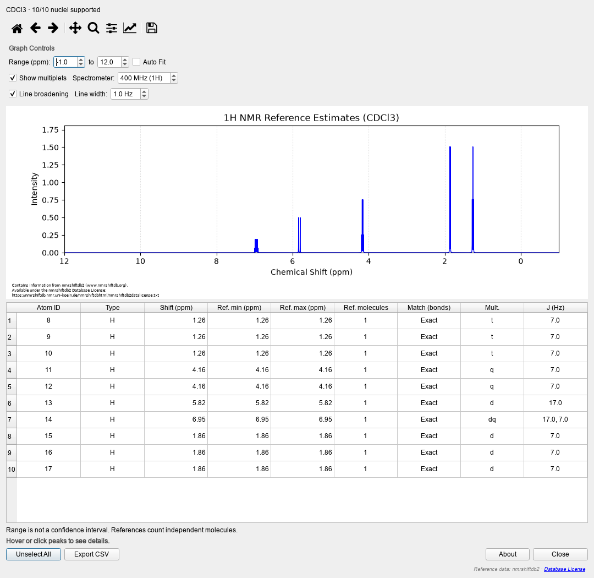
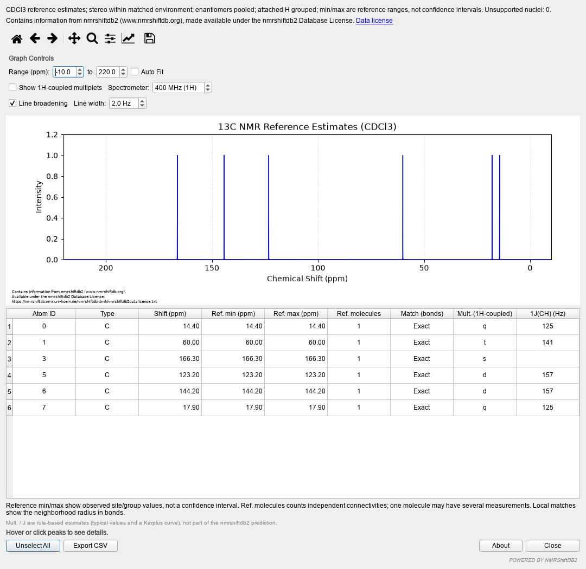

# Validation and benchmarks

[Back to the README](../README.md) · [Search architecture](../ARCHITECTURE.md)

The pinned export contains 58,187 records. The accepted subset and exact counts
are in [provenance.json](https://github.com/HiroYokoyama/moleditpy_nmr_predicator_nmrshiftdb2/blob/v4.0.3/nmr_predicator_nmrshiftdb2/data/provenance.json). Validation holds out entire nonstereochemical
molecular connectivities, including duplicate spectra and stereoisomers, so a
held-out molecule cannot also supply exact-structure or local training references.

| Solvent | Accepted spectra | 1H coverage | 1H MAE / ppm | 13C coverage | 13C MAE / ppm |
| --- | ---: | ---: | ---: | ---: | ---: |
| Acetone-d6 | 116 | 0.0% | — | 16.9% | 1.822 |
| C6D6 | 88 | 0.0% | — | 0.0% | — |
| CCl4 | 63 | 0.0% | — | 32.0% | 1.266 |
| CD3CN | 21 | 0.0% | — | 0.0% | — |
| CD3OD | 251 | 14.1% | 0.134 | 36.5% | 1.604 |
| CDCl3 | 2494 | 46.3% | 0.165 | 41.3% | 1.673 |
| D2O | 824 | 50.4% | 0.202 | 34.4% | 4.598 |
| DMSO-d6 | 407 | 29.9% | 0.361 | 42.0% | 1.843 |
| Pyridine-d5 | 62 | — | — | 21.9% | 1.097 |
| THF-d8 | 12 | — | — | — | — |

Errors refer only to supported targets. This is an internal held-out split of
one public export, not an independent experimental cohort or validation of
stereospecific H predictions. A dash means no supported held-out target or no
held-out data; it is not a successful accuracy estimate. RMSE, denominators and
per-radius results are in [provenance.json](https://github.com/HiroYokoyama/moleditpy_nmr_predicator_nmrshiftdb2/blob/v4.0.3/nmr_predicator_nmrshiftdb2/data/provenance.json). The shipped index then uses
the full accepted subset, including exact-stereostructure references. Coverage of an individual
molecule may be lower or higher than this table.

## Regression checks

The release checks cover complete, partial and absent references, including an
aromatic, saturated ring, ester, alkene, chiral acid and different solvents.
Across the 20 molecule/nucleus combinations below, shifts, reference ranges,
reference counts, atom assignments and unsupported-site lists match the verified
v4 regression baseline. The input molecule remains unchanged. Automated tests
also enforce these coverage and assignment cases.

| Molecule | Solvent | Supported 1H / total | Supported 13C / total |
| --- | --- | ---: | ---: |
| Benzene | CDCl3 | 6/6 | 6/6 |
| Toluene | CDCl3 | 8/8 | 7/7 |
| Ethyl acetate | CDCl3 | 8/8 | 4/4 |
| Cyclohexane | CDCl3 | 12/12 | 6/6 |
| Ethyl E-crotonate | CDCl3 | 10/10 | 6/6 |
| Ethyl Z-crotonate | CDCl3 | 5/10 | 2/6 |
| Ethanol | CDCl3 | 0/6 | 0/2 |
| Ethanol | D2O | 5/6 | 2/2 |
| Lactic acid | D2O | 0/6 | 0/3 |
| Aspirin | CDCl3 | 7/8 | 9/9 |

This checks functional stability and reference coverage, not independent
prediction accuracy. Zero support returns an explicit reference-unavailable
message; partial support leaves missing sites unsupported. Exchangeable protons
remain outside the model, and a selected solvent is never supplemented from
another solvent's data.

## Example: ethyl (E)-crotonate

Ethyl (E)-crotonate, `CCOC(=O)/C=C/C`, CDCl3. The reference search returns all **10 1H
nuclei** and all **6 13C nuclei**, with no unsupported sites in this example.
The exact reference is experimental SDF record **10015845**. All displayed sites
come from one independent molecular reference; equal min/max values here do not
establish zero prediction error. This is an in-database lookup/assignment and
performance check, not independent accuracy validation.



| 1H group | Shift / ppm | Reference range / ppm | Independent molecules | Mult. |
| --- | ---: | --- | ---: | --- |
| Ethyl CH3 | 1.26 | 1.26–1.26 | 1 | t |
| OCH2 | 4.16 | 4.16–4.16 | 1 | q |
| Alpha vinyl CH | 5.82 | 5.82–5.82 | 1 | d |
| Beta vinyl CH | 6.95 | 6.95–6.95 | 1 | dq |
| Alkene CH3 | 1.86 | 1.86–1.86 | 1 | d |



The 13C values are 14.4, 60.0, 166.3, 123.2, 144.2 and 17.9 ppm in the benchmark's
atom order. The screenshots show actual version 4 result dialogs.

Local benchmark, Python 3.13 / RDKit 2026.03.6 (median milliseconds):

| Operation | 1H / ms | 13C / ms |
| --- | ---: | ---: |
| Cold index cache: prediction | 55.89 | 55.40 |
| Warm cache: prediction | 1.03 | 1.00 |
| Prediction + coupling, existing 3D | 1.62 | 1.11 |
| Prediction + coupling, 2D input including embedding | 6.05 | 0.96 |

Warm prediction uses 100 repetitions; coupling uses 20 with 3D and 10 with 2D.
Cold measurements clear the Python index cache, not the operating system disk
cache. Imports, application startup and plotting are excluded. Reproduce with:

```sh
python scripts/benchmark_reference.py --output benchmark.json
```

